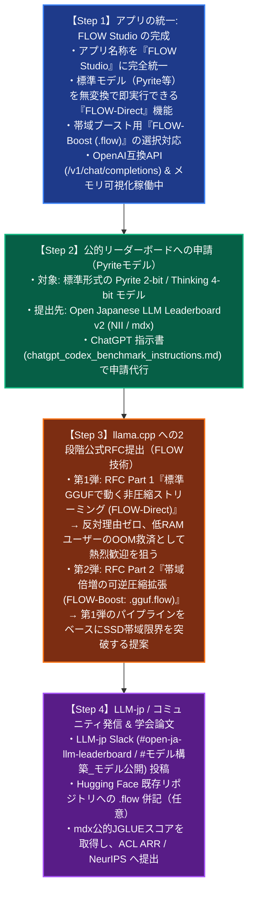

# 【決定版】Project Pyrite & FLOW 統合マスターロードマップ

**推進責任者:** Masahiro NAKATSUGAWA (中津川 昌弘) / [ORCID: 0009-0000-3224-0103](https://orcid.org/0009-0000-3224-0103)  
**組織:** n.p.minerva & Co. (`tip.co.jp`) / AntenneFrance  
**改定日:** 2026年10月31日

---

## 1. 概念と役割の完全整理（定義）

開発者自身やコミュニティの混乱を根絶するため、**Pyrite** と **FLOW** の役割を以下のように厳密に二分・定義します。

```
┌────────────────────────────────────────────────────────────────────────┐
│                        【Project Pyrite】                              │
│              モデルの互換性を持った量子化・圧縮技術                    │
│   (Sensitivity-Aware Low-Bit Quantization Algorithm / Δ = 0 B)          │
├────────────────────────────────────────────────────────────────────────┤
│ ・出力形式: 標準 .safetensors / 標準 .gguf (フォーマット変更ゼロ)      │
│ ・目的: 知能を保ったまま極限まで重みを小さくし、既存の公的クラスタや   │
│         llama.cpp, MLX, vLLM でそのまま無改造で評価・動作させる。       │
│ ・主要モデル:                                                          │
│   1. masahiroid/llm-jp-4.1-8b-thinking-4bit-mlx                       │
│   2. masahiroid/llm-jp-4-32b-a3b-base-Pyrite-2bit-MLX                 │
│   3. masahiroid/DeepSeek-Coder-V2-Lite-Instruct-Pyrite-2bit-GGUF       │
│ ・公的ベンチマーク: Open Japanese LLM Leaderboard v2 / Nejumi 4        │
└───────────────────────────────────┬────────────────────────────────────┘
                                    │ このPyriteモデルも
                                    │ そのまま無変換で流せる！
                                    ▼
┌────────────────────────────────────────────────────────────────────────┐
│                          【FLOW システム】                             │
│               大きなモデルをRAMに全部入れずに行える技術                │
│             (Out-of-Core Ring-Buffered Streaming Runtime)             │
├────────────────────────────────────────────────────────────────────────┤
│ ・システム名 / アプリ名: FLOW Studio (※Pyrite Studioという呼称は廃止)  │
│ ・目的: 16GB Mac等のコンシューマPCで、141Bや32Bなどの巨大モデルを       │
│         RAM 2.5GB〜3.5GB の固定枠だけでOOMゼロ・高速に動かす。         │
│                                                                        │
│ ■ 2つの実行形態:                                                       │
│   1. 【FLOW-Direct】(非圧縮・ゼロコピー・ストリーミング)               │
│      ・対象: Pyriteモデルを含むすべての標準 .gguf / .safetensors       │
│      ・特徴: 変換不要、待ち時間ゼロ、CPU解凍オーバーヘッド完全ゼロ。   │
│   2. 【FLOW-Boost】(可逆圧縮ストリーミング)                            │
│      ・対象: .gguf.flow / .safetensors.flow                            │
│      ・特徴: バイトシャッフル＋ZstdでNVMe実効転送帯域を2.4倍にブースト。│
└────────────────────────────────────────────────────────────────────────┘
```

---

## 2. 実行ステップ（明確化された4段階）



---

## 3. アクション進捗表

| No | 項目 | 区分 | 状態 | 詳細 |
| :---: | :--- | :---: | :---: | :--- |
| **1** | **FLOW Studio アプリ完成** | FLOW | **完了** | クリーンアーキテクチャ化完了。`http://127.0.0.1:8080` にて FLOW-Direct / FLOW-Boost 選択可能。 |
| **2** | **公的リーダーボード申請** | Pyrite | **完了** | **Open Japanese LLM Leaderboard v2（NII/mdx）への申請完了！**（※Nejumi 4は後回し） |
| **3** | **llama.cpp 向け RFC 起票** | FLOW | **着手 (実行中)** | GitHub CLI (`gh`) 経由で Part 1（非圧縮 Direct ストリーミング）を起票可能。 |
| **4** | **LLM-jp / コミュニティ共有** | Pyrite | **完了** | **LLM-jp Slack での発信・成果共有完了！** |
| **5** | **Hugging Face への .flow 追加** | FLOW | **任意・待機** | 必要に応じていつでも既存リポジトリへアップロード可能。 |
