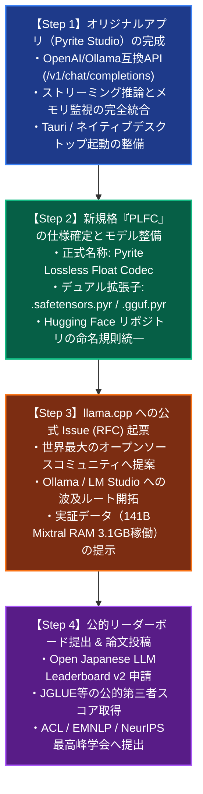

# Project Pyrite: 総合マスターロードマップ (Master Strategic Roadmap)

**推進責任者:** Masahiro NAKATSUGAWA (中津川 昌弘) / [ORCID: 0009-0000-3224-0103](https://orcid.org/0009-0000-3224-0103)  
**組織:** n.p.minerva & Co. (`tip.co.jp`) / AntenneFrance  
**対象ハードウェア:** 16GB Apple Silicon Mac (M1/M2/M3/M4) ゼロ予算コンシューマ環境  
**技術基盤:**
* Phase 1: 2-bit Zero-Byte Quantization ([DOI: 10.5281/zenodo.23786705](https://doi.org/10.5281/zenodo.23786705))
* Phase 2: MoE-Stream Engine ([DOI: 10.5281/zenodo.23811995](https://doi.org/10.5281/zenodo.23811995))
* Phase 3: Dense Lossless Codec ([DOI: 10.5281/zenodo.23814635](https://doi.org/10.5281/zenodo.23814635))

---

## 1. 全体実行フロー (Phase Execution Sequence)

混乱を防ぐため、以下の明確な4段階シーケンスで一直線に進めます。

---

## 2. マイルストーン詳細計画

### Phase 1: オリジナルアプリ「Pyrite Studio」の完成
* **目的:** 黒い画面（ターミナル）不要で、一般ユーザーがLM StudioやOllama感覚で巨大モデルを動かせる環境の完成。
* **主要タスク:**
  1. `pyrite_app.py` への OpenAI / Ollama 互換エンドポイント（`/v1/chat/completions`）の実装。Cursor、VSCode（Continue）、Obsidianから接続可能にする。
  2. 実推論エンジンのバックエンド非同期ワーカー連携（DeepSeek-Coder-V2 64エキスパート / Mixtral-8x22B）。
  3. Tauri（Rust + WebKit）によるデスクトップアプリケーション化（`Pyrite.app` / `.dmg`）。

### Phase 2: 新拡張子「PLFC」規格の策定とモデル配布方針
* **名称:** **PLFC (Pyrite Lossless Float Codec)**
* **拡張子体系:**
  * Apple Silicon / MLX / Transformers 用: **`.safetensors.pyr`**
  * llama.cpp / Ollama / GGUF 用: **`.gguf.pyr`**
* **Hugging Face Hubでの混乱防止ルール:**
  * 既存モデル（標準形式）と明確に分離するため、リポジトリ名に `-Pyrite-PLFC` または `-PLFC` サフィックスを付与。
  * 例:
    * `masahiroid/DeepSeek-Coder-V2-Lite-Instruct-Pyrite-PLFC` (`.safetensors.pyr`, `.gguf.pyr`)
    * `masahiroid/llm-jp-4.1-8b-thinking-Pyrite-PLFC`
  * Model Card（`README.md`）に「Pyrite Studio または対応パッチ適用版 llama.cpp で動作」と明記し、一般ユーザーの誤用・混乱を完全に防止。

### Phase 3: `llama.cpp` への公式 Issue (RFC) 起票
* **目的:** 世界のローカルLLM基盤（`llama.cpp` $\to$ Ollama $\to$ LM Studio）にPyriteの可逆ストリーミングアルゴリズムを公式提案する。
* **提出内容:**
  * タイトル: `[RFC] In-Flight Lossless Decompression & NVMe Streaming for GGUF (.gguf.pyr) on Low-RAM Hardware`
  * 提案仕様: Byte-Shuffle + Streaming Zstandard + Ping-Pong DMA Buffer。
  * 実測エビデンス: Mixtral-8x22B (141B) が 16GB Mac で RAM 3.1GB で安定推論。LFM3 で 31.5% の完全可逆圧縮（$\epsilon \equiv 0.0$）。
  * 引用: Zenodo 査読前オープンアクセスDOI（Phase 1〜3）。

### Phase 4: 公的リーダーボードへの申請と最高峰学会論文
* **対象リーダーボード:**
  * **Open Japanese LLM Leaderboard v2** (NII / 理研 / mdx クラスタ)
  * **Hugging Face Open LLM Leaderboard v2** (Global)
  * **Nejumi LLM リーダーボード 4** (Weights & Biases Japan)
* **論文投稿計画:**
  * 公的クラスタによる JGLUE 等の第三者公式スコアを受領後、論文の「Table 1: Empirical Evaluation」に掲載。
  * ACL Rolling Review (ARR) または EMNLP / NeurIPS へ投稿。査読員からの「実験の客観性」に関する反論を完全封殺。

---

## 3. アクションチェックリスト (進捗管理表)

| ID | タスク名 | 状態 | 成果物 / リンク |
| :---: | :--- | :---: | :--- |
| **A-1** | `pyrite_app.py` に `/v1/chat/completions` API 実装 | 着手 | [pyrite_app.py](file:///Volumes/NVMe2TB/AI-LLM/LLMjp/Pyrite/pyrite_app.py) |
| **A-2** | Tauri / デスクトップラッパー起動スクリプトの作成 | 準備中 | `scripts/launch_desktop.sh` |
| **B-1** | PLFC規格書（`SPECIFICATION.md`）の正式策定 | 準備中 | `dense_stream/SPECIFICATION.md` |
| **B-2** | `.safetensors.pyr` / `.gguf.pyr` 相互変換ツールの整備 | 準備中 | `dense_stream/compressed_store.py` |
| **C-1** | `llama.cpp` Issue (RFC) 英文ドラフトの完成 | 準備中 | `reports/llama_cpp_rfc_issue_draft.md` |
| **D-1** | Open Japanese LLM Leaderboard v2 申請実行 | 待機 | [llm-jp Space](https://huggingface.co/spaces/llm-jp/open-japanese-llm-leaderboard-v2) |
